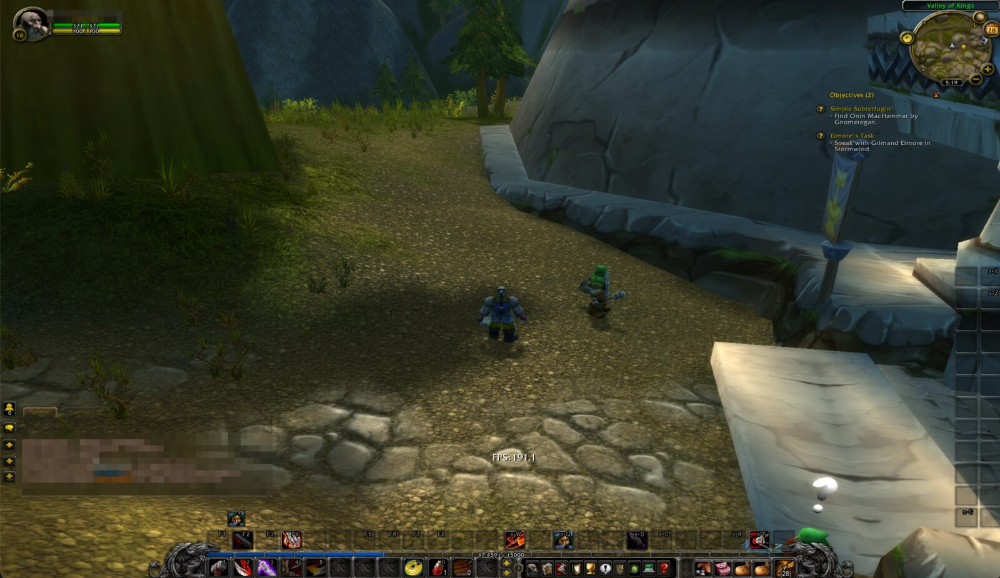
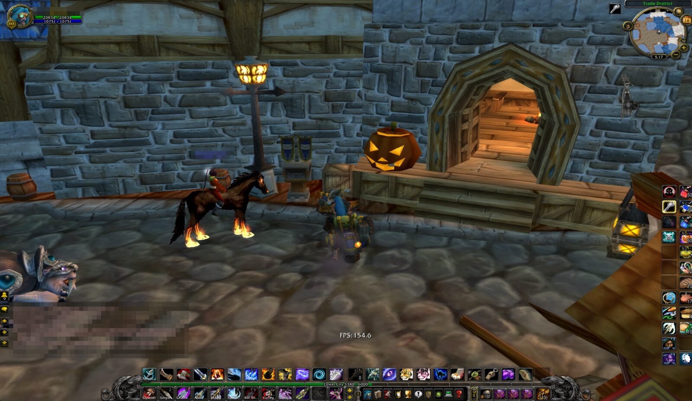
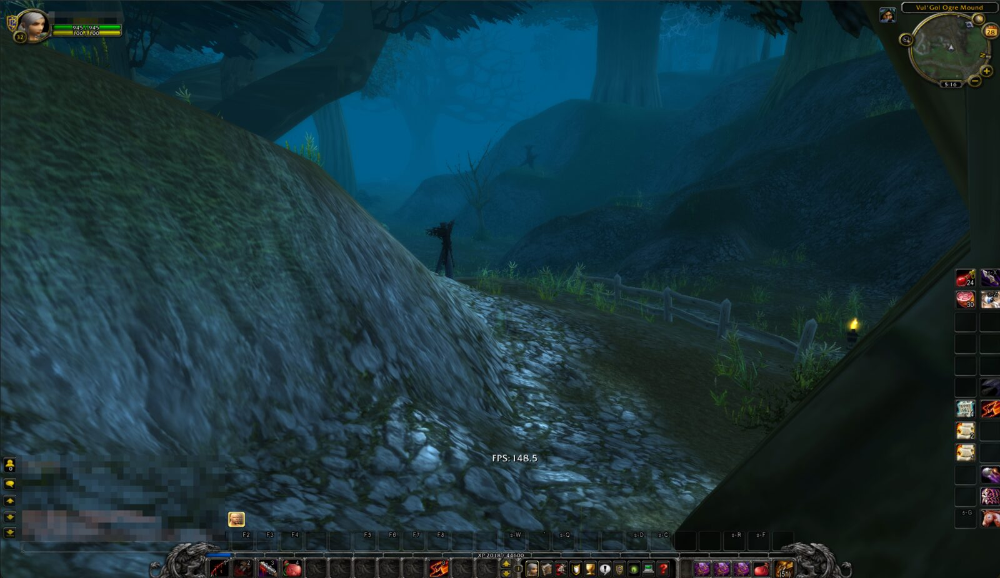
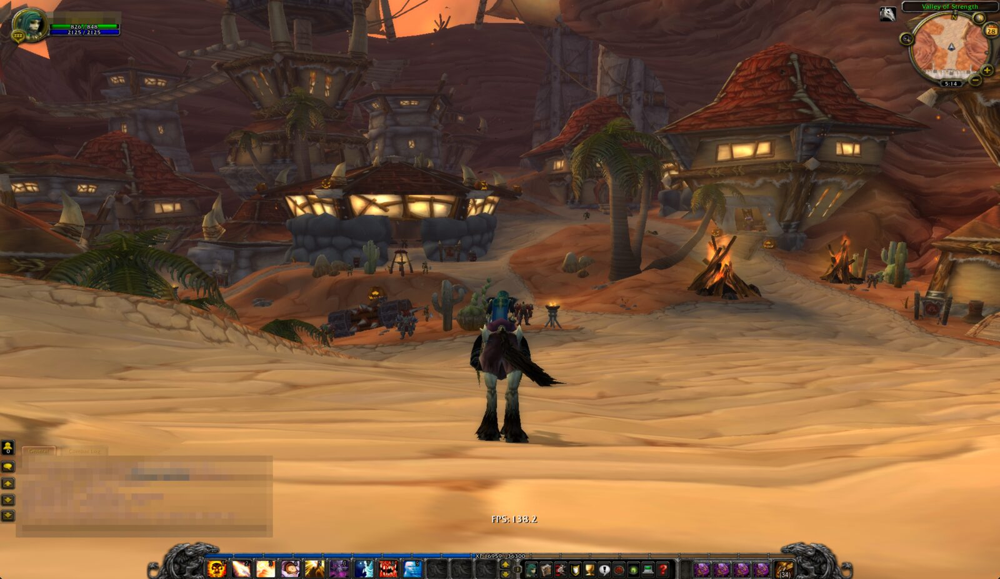
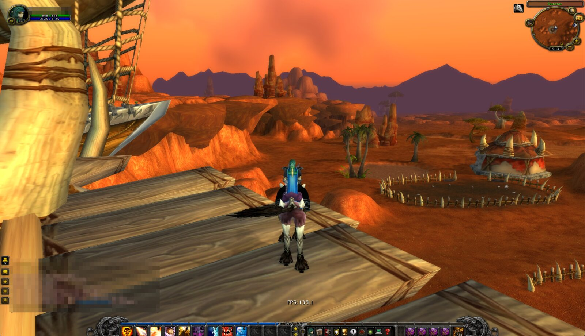
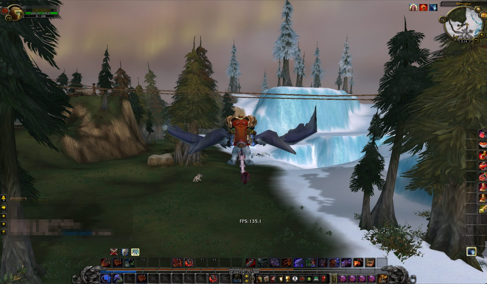
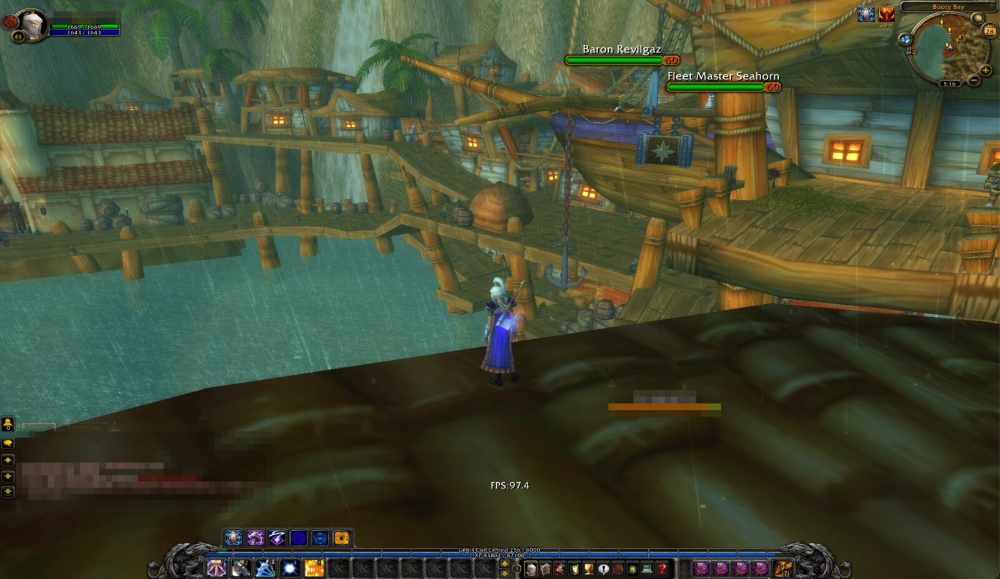
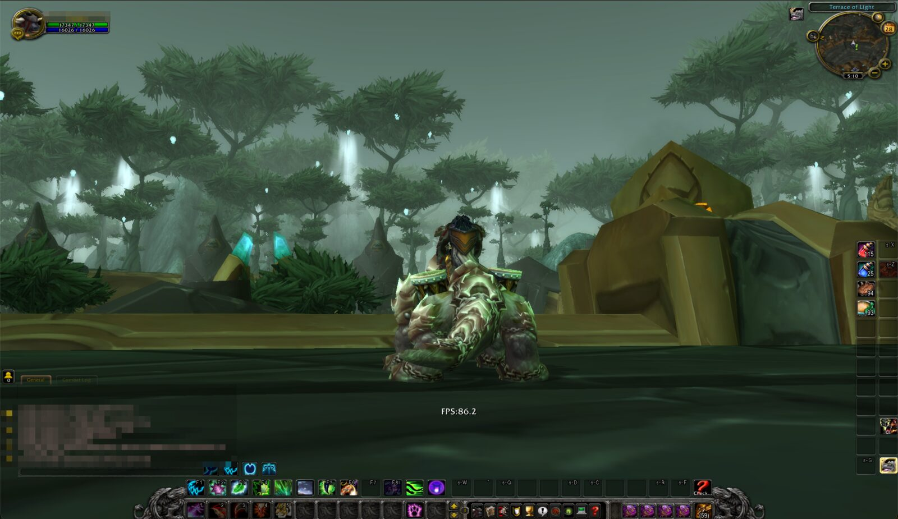

# MoBetta

Custom Wine engine for running World of Warcraft 3.3.5a (WotLK) on Apple Silicon Macs.

## The Problem

WoW 3.3.5a crashes at character select when running under Wine on Apple Silicon:

```
ERROR #132 (0x85100084) Fatal Exception
Exception: 0xC000001D (ILLEGAL_INSTRUCTION)
```

This affects all old WoW clients (1.12, 2.4.3, 3.3.5a) because Rosetta 2 doesn't implement certain legacy x86 instructions.

## The Solution

MoBetta is a Wineskin engine. Everything happens inside Wine:

- **The crash:** Wine's signal handler emulates the instructions Rosetta 2 rejects (`ARPL` and nine undocumented x87 opcodes), exactly as real x86 hardware runs them
- **The frame rate:** game processes start under [x87sidecar](https://github.com/athei/x87sidecar), which makes Rosetta translate the game's x87 floating point to native ARM code instead of a slow software path. **20 FPS -> 80 FPS average** (106 max)
- **Graphics buffers:** Wine's OpenGL keeps the low-memory view of a graphics buffer between maps instead of rebuilding it every time. Up to ~20% more FPS, 127 max
- **DEP** stays on under Rosetta, as on Windows
- **Direct3D 9 on Metal:** our build of [mtld3d](https://github.com/athei/mtld3d), without the hooks its release puts into the game's memory, with HDR off and its logs kept out of the game folder. ~140 FPS at the inn (was 60-80), ~170 in a light view

**Key constraint:** No game file modifications, nothing injected into the game process. This engine is designed for use with servers that run anti-cheat systems. A SHA-256 baseline of the game folder is checked before and after every test.

## Performance

In game with the v1.0.0 engine on a MacBook M3, windowed, medium-high graphics settings, FPS from the in-game counter (Ctrl+R). Shattrath and Booty Bay in the rain run lowest.

| Place | FPS |
|-------|-----|
| Loch Modan, Valley of Kings (Ironforge gate) | 191 |
| Stormwind, Trade District | 155 |
| Duskwood | 149 |
| Orgrimmar, Valley of Strength | 138 |
| Durotar, zeppelin tower | 135 |
| Howling Fjord, Kamagua | 135 |
| Booty Bay, rain | 97 |
| Shattrath City | 86 |

<table>
  <tr>
    <td><a href="docs/screenshots/loch-modan.jpg"></a><br>Loch Modan, 191 FPS</td>
    <td><a href="docs/screenshots/stormwind.jpg"></a><br>Stormwind, 155 FPS</td>
  </tr>
  <tr>
    <td><a href="docs/screenshots/duskwood.jpg"></a><br>Duskwood, 149 FPS</td>
    <td><a href="docs/screenshots/orgrimmar.jpg"></a><br>Orgrimmar, 138 FPS</td>
  </tr>
  <tr>
    <td><a href="docs/screenshots/durotar.jpg"></a><br>Durotar, 135 FPS</td>
    <td><a href="docs/screenshots/howling-fjord.jpg"></a><br>Howling Fjord, 135 FPS</td>
  </tr>
  <tr>
    <td><a href="docs/screenshots/booty-bay.jpg"></a><br>Booty Bay, 97 FPS</td>
    <td><a href="docs/screenshots/shattrath.jpg"></a><br>Shattrath City, 86 FPS</td>
  </tr>
</table>

Chat and character names are blurred in the screenshots.

## Status

- [x] Phase 1: Confirm faulting instructions
- [x] Phase 2: Reproducible engine build
- [x] Phase 3: Instruction emulation (in game: past character select, playing in the world)
- [x] Phase 3b: Performance (20 -> 80 FPS average, 30+ minute sessions; buffer mapping up to ~20% more)
- [x] Engine package `WS12WineCX26.3_Mobetta`
- [x] mtld3d (Direct3D 9 on Metal) in the engine package (~140 FPS at the inn)
- [x] One build script for the whole engine, reproducible from any directory
- [x] Release: download, install guide, checksums
- [ ] Phase 4: Wider testing

See [CHANGELOG.md](CHANGELOG.md) for details.

## Requirements

- **Mac:** Apple Silicon (M1 or later) with Rosetta 2 installed
- **Porting Kit or Wineskin installed:** [Porting Kit](https://www.portingkit.com) or [Wineskin Winery](https://github.com/Gcenx/WineskinServer), with a wrapper (port) for the game already set up and working
- **Game:** WoW 3.3.5a (build 12340)
- **Tested on:** MacBook M3, macOS 27
- **Base:** CrossOver 26.3 Wine (Porting Kit's engine `WS12WineCX26.3_DXMT`)

## Installing

Setting up a new Porting Kit port for the game? Follow the [Porting Kit guide with screenshots](docs/PORTING_KIT.md). For a wrapper you already have:

1. Download `WS12WineCX26.3_Mobetta.tar.7z` and `SHA256SUMS` from the [latest release](https://github.com/rawdata369/MoBetta/releases/latest)
2. Check the download. In Terminal, in the folder you saved both files to:
   ```bash
   shasum -a 256 -c SHA256SUMS      # must print: WS12WineCX26.3_Mobetta.tar.7z: OK
   ```
3. Move `WS12WineCX26.3_Mobetta.tar.7z` into `~/Library/Application Support/Wineskin/Engines/` (in Finder: Go > Go to Folder..., paste the path). This folder comes from Porting Kit or Wineskin Winery, so one of them must be installed first (see [Requirements](#requirements)); create the `Engines` folder if it isn't there. Leave the file packed, as the other engines there are. `Library` is a hidden folder: if you browse to it in Finder, press Shift + Cmd + . (period) to show hidden folders.
4. Switch the game's wrapper to the engine:
   - Quit the game. In Finder, right-click the game's wrapper app, Show Package Contents, open `Contents/Wineskin.app`
   - **Advanced** > **Tools** > **Change Engine Used**, pick `WS12WineCX26.3_Mobetta`, OK
   - With Wineskin Winery you can also pick the engine when you create a new wrapper
5. Start the game as usual. The first start on this engine updates the wrapper's Wine prefix once, as after any engine change

To go back, change the engine to the one the wrapper had before (for a Porting Kit port, usually `WS12WineCX26.3_DXMT`).

mtld3d writes its log to `drive_c/users/<user>/AppData/Local/mtld3d-logs/` in the prefix.

## Building

The release engine can be rebuilt from source and compared with the download. Requires Xcode Command Line Tools, Homebrew (`bison`, `cmake`, `sevenzip`, `gh`, logged in), rustup (stable, targets `i686-pc-windows-msvc` and `x86_64-apple-darwin`, `llvm-tools`) with `cargo install --locked xwin`, plus the stock engine `WS12WineCX26.3_DXMT.tar.7z` (SHA-256 `7b3f383a2209de5765eef45f1d6fc316682cfcfbb3518d7470e4b51f00e7cd08`) in Wineskin's Engines folder. Porting Kit downloads it there when a port is set up with that engine.

```bash
bash scripts/build_engine.sh       # -> build/engine/WS12WineCX26.3_Mobetta.tar.7z
```

It downloads the sources (each pinned by hash or commit), builds Wine's `ntdll.so` and `opengl32.so` with `patches/` applied, x87sidecar and mtld3d, packages the engine, and checks it against the release SHA-256 in [`SHA256SUMS`](SHA256SUMS). The build gives the same bytes in any directory. The steps also run on their own: `build_opengl32.sh`, `build_x87sidecar.sh`, `build_mtld3d.sh`, `package_engine.sh`. mtld3d always builds in `/private/tmp/mobetta-mtld3d`, because its output depends on the build path; on a Mac with several users, only one of them can build there at a time.

## Tests

```bash
bash scripts/test_emu.sh           # instruction emulation, 4153 checks
bash scripts/test_dep.sh --wine    # DEP patch
bash scripts/test_x87.sh           # x87sidecar start-up and speed
bash scripts/baseline.sh verify    # game folder unchanged
```

## References

- [Whisky Issue #537](https://github.com/Whisky-App/Whisky/issues/537) - WoW crashes on Apple Silicon
- [Wine Bug 56441](https://bugs.winehq.org/show_bug.cgi?id=56441) - FNDISI patch precedent
- [x87sidecar](https://github.com/athei/x87sidecar) - x87 acceleration for Rosetta 2 (MIT), shipped in the engine
- [athei/wine](https://github.com/athei/wine) - source of the DEP and x87sidecar ntdll patches we ported
- [mtld3d](https://github.com/athei/mtld3d) - Direct3D 9 on Metal (Zlib), shipped in the engine; we build it without the import-table hooks its release installs (`scripts/build_mtld3d.sh`, `patches/mtld3d/`)
- [Endfield_FineWine](https://github.com/stoicswe/Endfield_FineWine) - CrossOver patching example

## License

MoBetta (patches, scripts and docs) is licensed under the GNU Lesser General Public License, version 2.1 or later, the same as Wine; see [LICENSE](LICENSE).

The engine package contains:

| Part | License | Source |
|------|---------|--------|
| Wine (CrossOver 26.3.0), with `patches/` in `ntdll.so` and `opengl32.so` | LGPL 2.1 or later (`share/doc/wine/COPYING.LIB`) | [crossover-sources-26.3.0.tar.gz](https://media.codeweavers.com/pub/crossover/source/crossover-sources-26.3.0.tar.gz) + [`patches/`](patches) |
| mtld3d v0.15.1, with `patches/mtld3d/` | Zlib (`share/doc/mtld3d/LICENSE`) | [athei/mtld3d](https://github.com/athei/mtld3d) + [`patches/mtld3d/`](patches/mtld3d) |
| x87sidecar | MIT (`share/doc/x87sidecar/LICENSE`) | [athei/x87sidecar](https://github.com/athei/x87sidecar) |

`share/doc/mobetta/SOURCE` in the engine lists what changed from the stock engine and the exact source versions. Every other file is Porting Kit's stock `WS12WineCX26.3_DXMT`, unchanged.

## Disclaimer

This project is not affiliated with Blizzard Entertainment, any private server, or CodeWeavers. Use at your own risk.
