# New Porting Kit port with MoBetta

A step-by-step guide to setting up WoW 3.3.5a in a new Porting Kit port that runs the MoBetta engine. If you already have a working port, skip to [Switch an existing port to MoBetta](#switch-an-existing-port-to-mobetta).

## Before you start

- An Apple Silicon Mac (M1 or later) with Rosetta 2. If macOS has never asked you to install it, run `softwareupdate --install-rosetta` in Terminal
- [Porting Kit](https://www.portingkit.com) or [Wineskin Winery](https://github.com/Gcenx/WineskinServer) installed. This guide uses Porting Kit; with Wineskin Winery on its own, pick `WS12WineCX26.3_Mobetta` when you create the wrapper, or switch an existing one as in [Switch an existing port to MoBetta](#switch-an-existing-port-to-mobetta)
- The WoW 3.3.5a (build 12340) client, for example Warmane's download

## Add the MoBetta engine

Do this after Porting Kit or Wineskin Winery is installed: installing one of them creates the Engines folder.

1. Download `WS12WineCX26.3_Mobetta.tar.7z` from the [latest release](https://github.com/rawdata369/MoBetta/releases/latest)
2. Move it, still packed, into `~/Library/Application Support/Wineskin/Engines/`. Do this before you start the port, so Porting Kit lists the engine in step 4. If you skip it, pick a temporary engine in step 4 and [switch to MoBetta](#switch-an-existing-port-to-mobetta) afterwards

`Library` is hidden in Finder: use Go > Go to Folder..., or press Shift + Cmd + . (period) to show hidden folders.

**Recommended: check the download.** Also download `SHA256SUMS` from the release, then in Terminal, in the folder with both files, run `shasum -a 256 -c SHA256SUMS`. It must print `WS12WineCX26.3_Mobetta.tar.7z: OK`.

## 1. Put the game in its own folder

Create a folder for the game, for example `~/Games/WoW-3.3.5a`, and put the whole 3.3.5a client in it (the folder that contains `Wow.exe`). The port does not copy the game: it runs `Wow.exe` from this folder, so leave the folder where it is and don't rename it after the port is set up.

## 2. Start a custom port

Open Porting Kit, select **All apps** in the left menu, and click **Custom Port**.

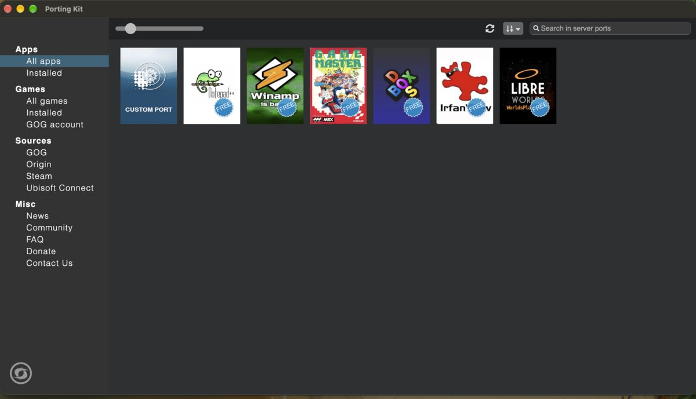

Porting Kit asks for the port's name. Type one, for example `wotlk 3.3.5`, and click **OK**.

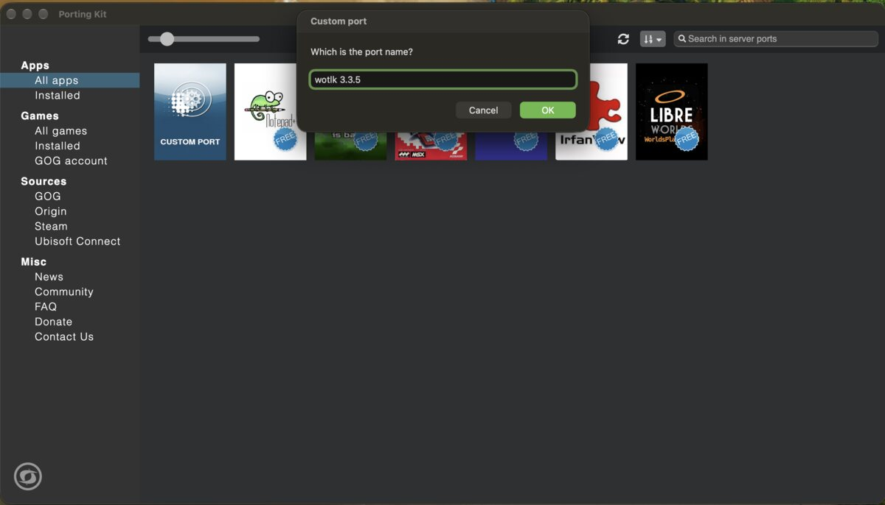

## 3. Introduction and Agreement

Click **Next** on the Introduction, read the Agreement, and click **Next**.

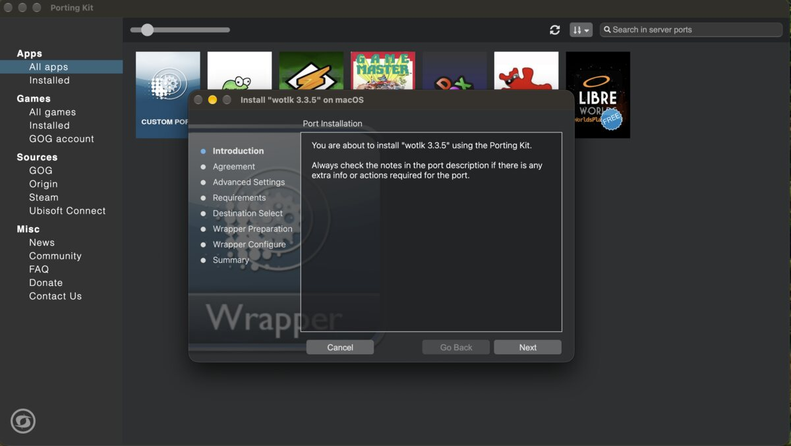

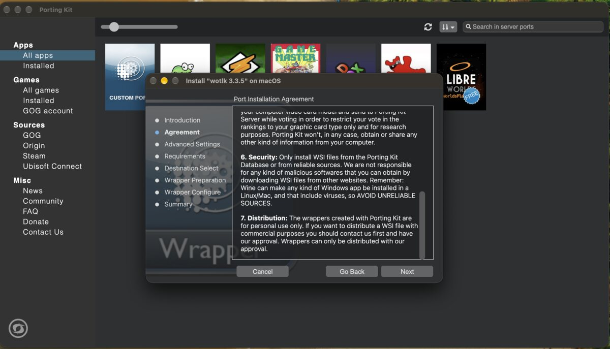

## 4. Advanced Settings: pick the engine

Open the **Engine** list and pick **WS12WineCX26.3_Mobetta**. It appears only if the engine file is already in the Engines folder (see [Add the MoBetta engine](#add-the-mobetta-engine)). If it isn't there yet, pick **WS12WineCX26.3_DXMT**, the engine MoBetta is built on, and [switch to MoBetta](#switch-an-existing-port-to-mobetta) when the port is done.

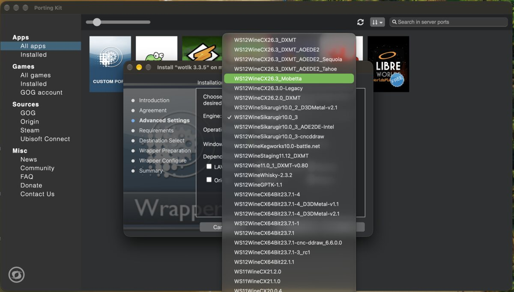

Leave the rest as it is (Windows 10, Mac Driver, no extra dependencies) and click **Next**.

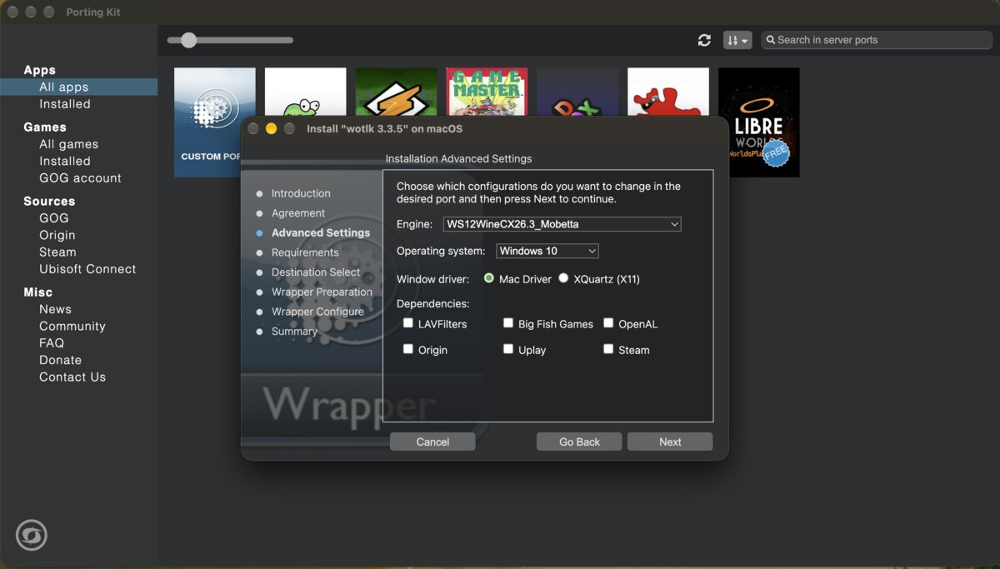

## 5. Requirements

This screen only reminds you that you need the game's `.exe` file. Click **Next**.

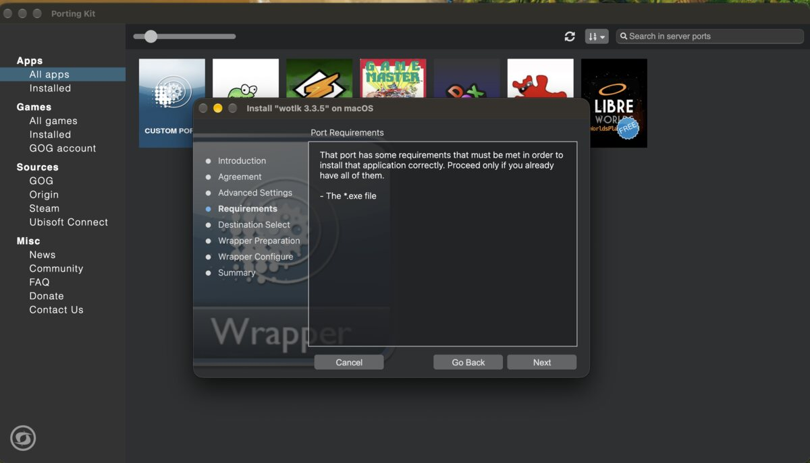

## 6. Destination Select

This is where the port (the wrapper app) will be saved. Keep the default or click **Change Install Location...** to pick another folder. This is not the game folder from step 1. Click **Install**.

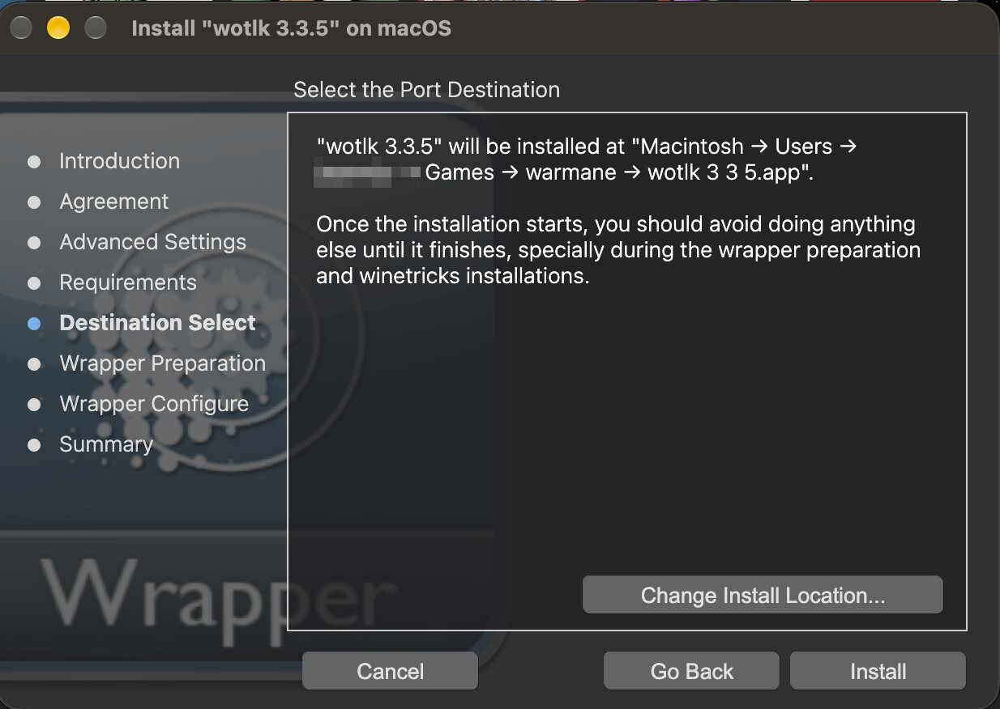

## 7. Select Wow.exe, let the wrapper install

When Porting Kit asks for the program to run, go to the game folder from step 1 and select `Wow.exe`.

Porting Kit then prepares the wrapper and installs what it needs. This takes a few minutes; leave the Mac alone meanwhile. At some point the game starts and its window appears. **Quit the game** so the setup can finish.

## 8. Select Wow.exe again

Porting Kit asks once more for the game's executable, this time to set what the port launches. Go to the game folder again and select `Wow.exe`. The port is now done.

## 9. Play, and turn off Vertical Sync

Start the port from where you saved it in step 6. In game, open the menu (Esc) > **Video** and untick **Vertical Sync**. With Vertical Sync on, the frame rate is held to your display's refresh rate; with it off, MoBetta runs well past it (see the [Performance](../README.md#performance) numbers).

## Switch an existing port to MoBetta

For a port made with another engine, or one you already had:

1. Put the engine in the Engines folder, as in [Add the MoBetta engine](#add-the-mobetta-engine)
2. Quit the game. In Finder, right-click the port's app and choose **Show Package Contents**

   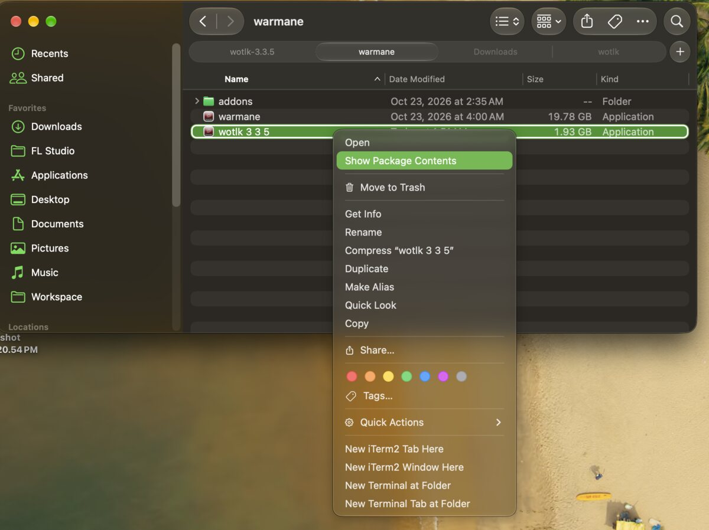

3. Open `Contents`, then open `Wineskin`

   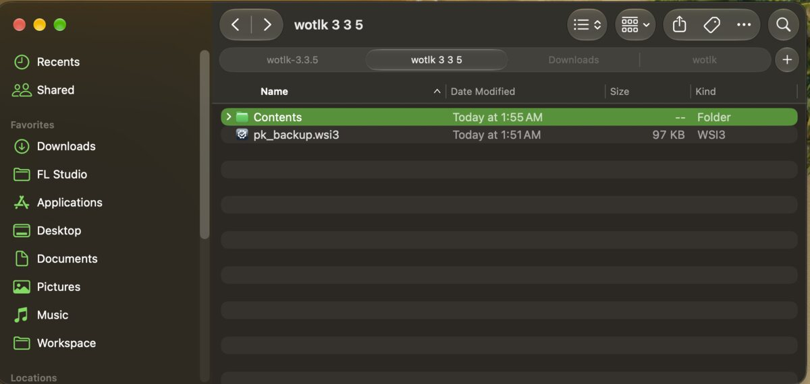

   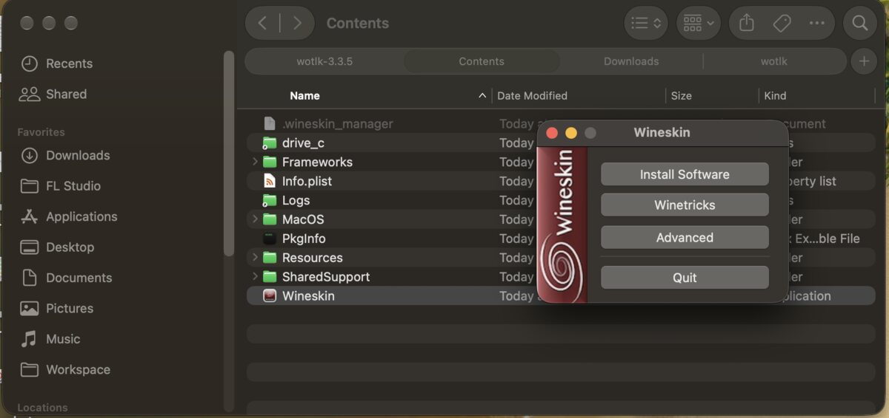

4. Click **Advanced**, go to the **Tools** tab and click **Change Engine Used**

   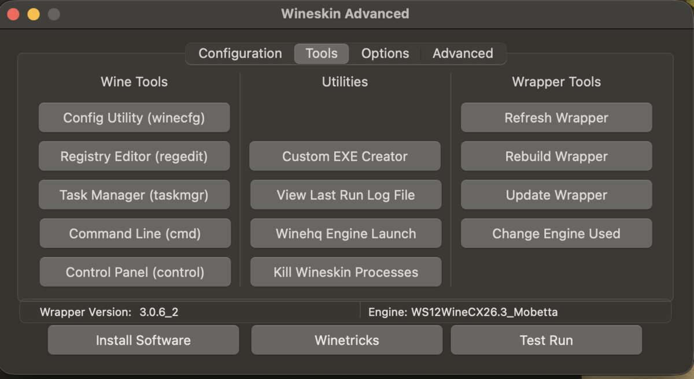

5. Pick **WS12WineCX26.3_Mobetta** and click **OK**. The bottom of the Tools tab then shows `Engine: WS12WineCX26.3_Mobetta`

   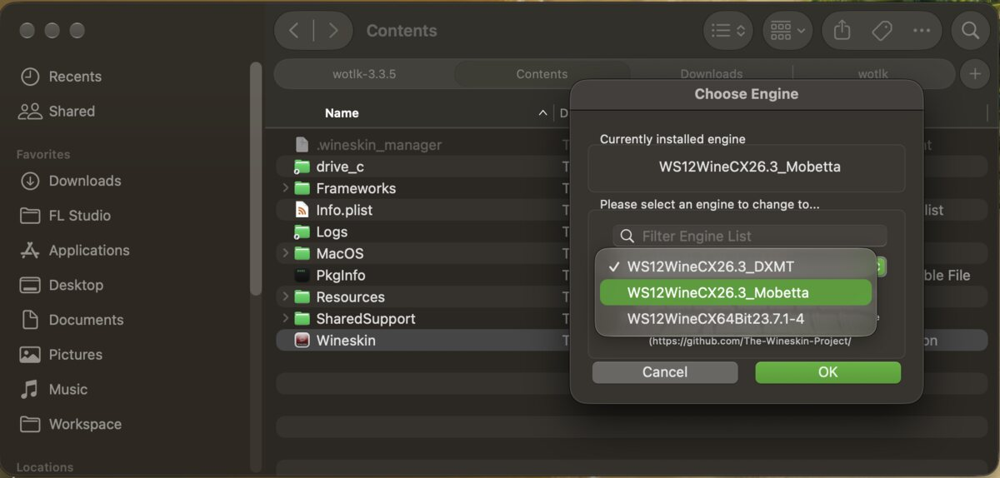

6. Start the game as usual. The first start on the new engine updates the port's Wine setup once

To go back, change the engine to the one the port had before (usually `WS12WineCX26.3_DXMT`).

MoBetta doesn't modify the game folder and doesn't inject anything into the game; all changes are in the Wine engine.
